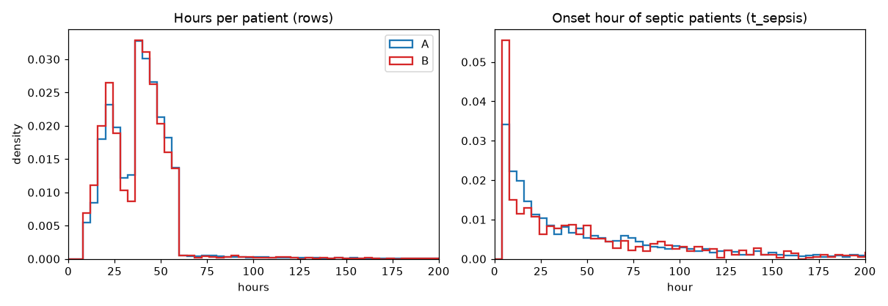
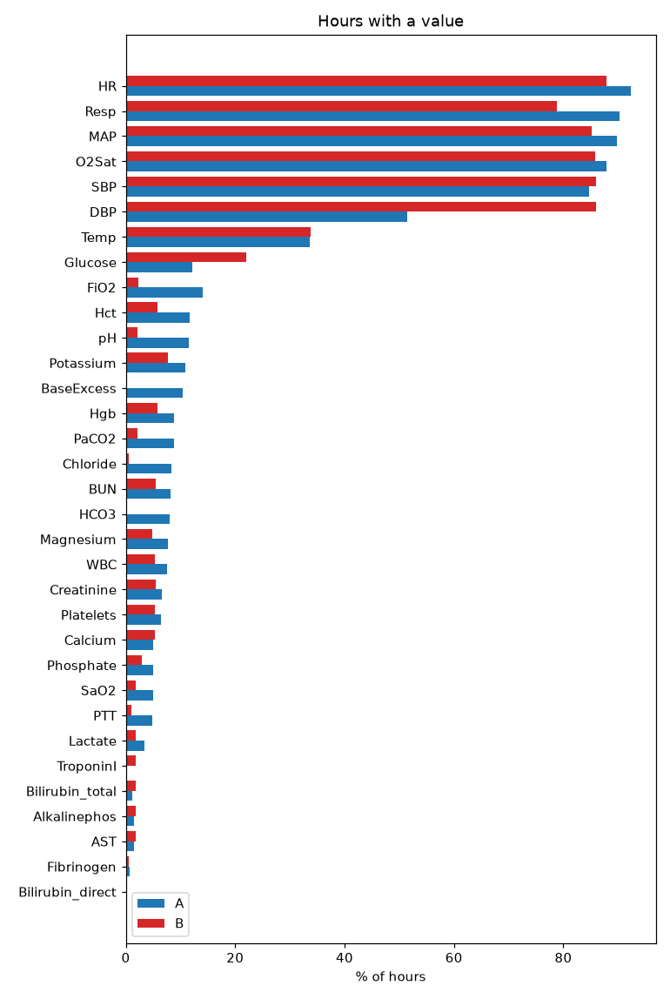
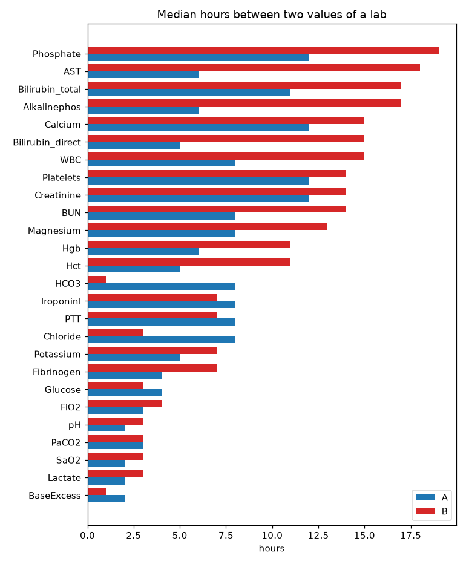
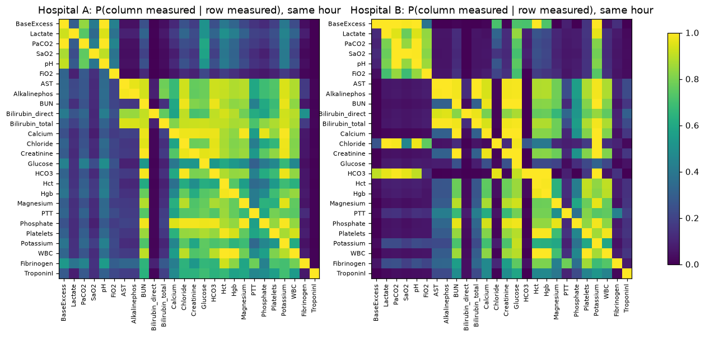
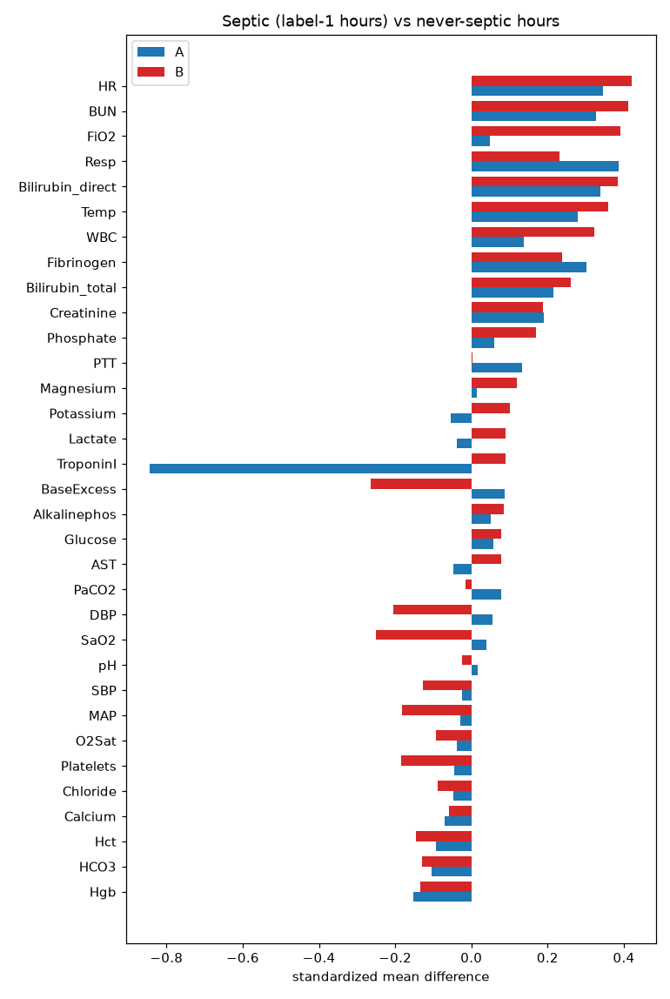
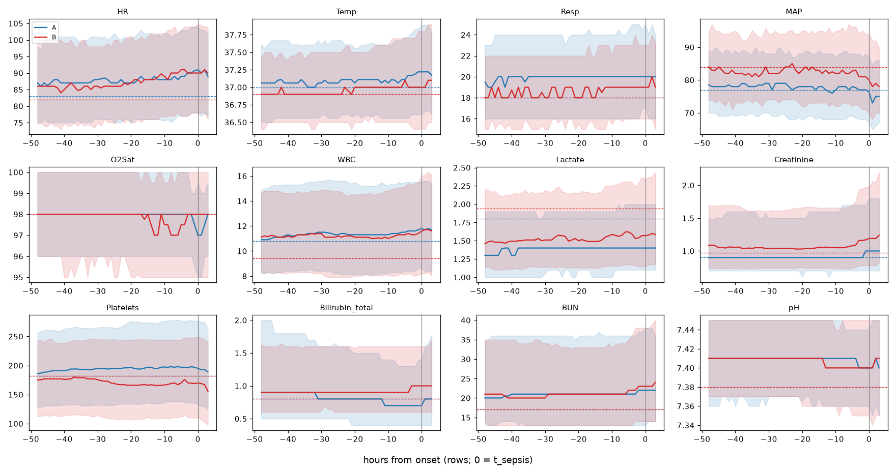
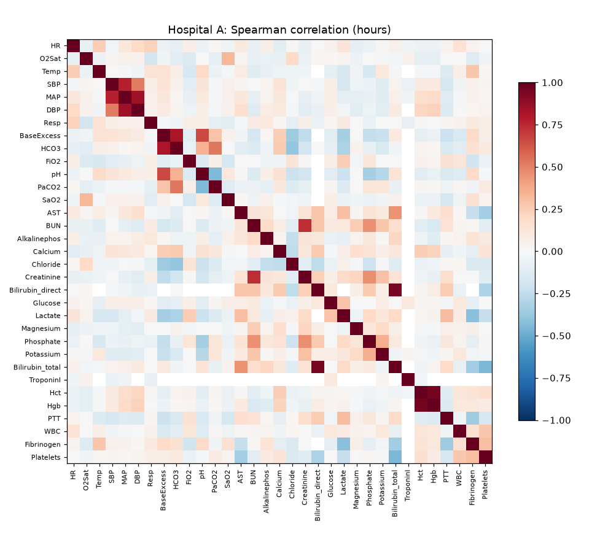
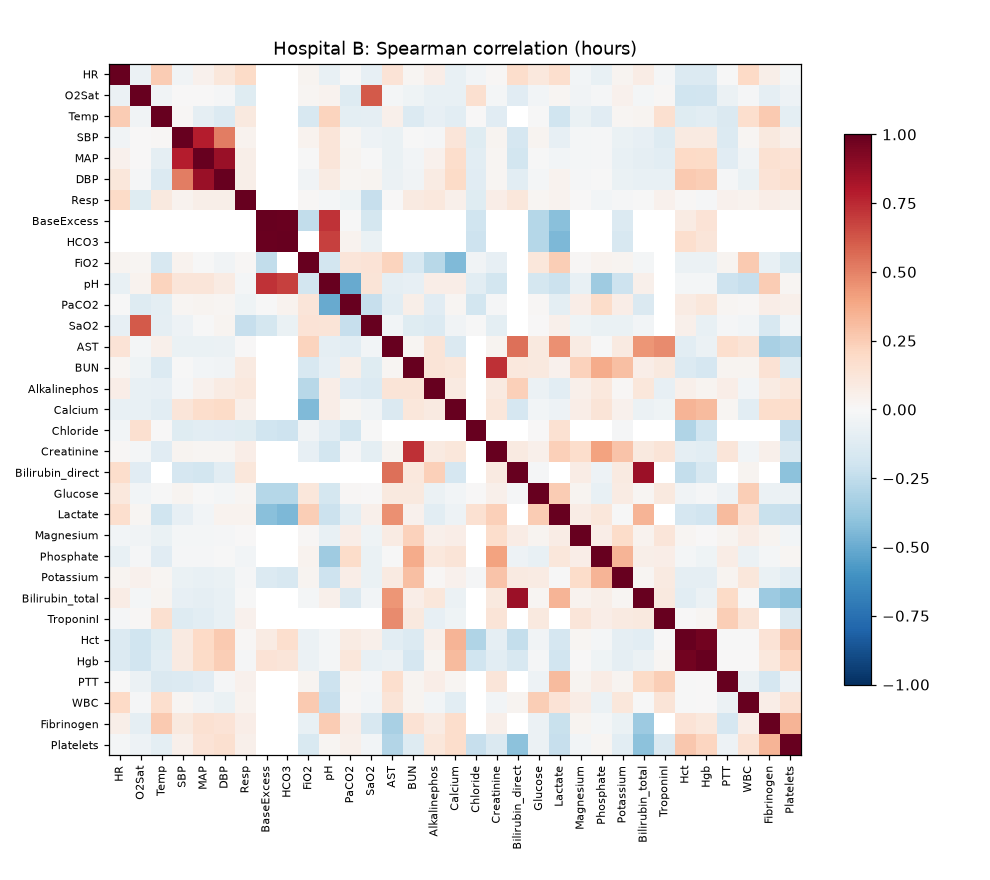
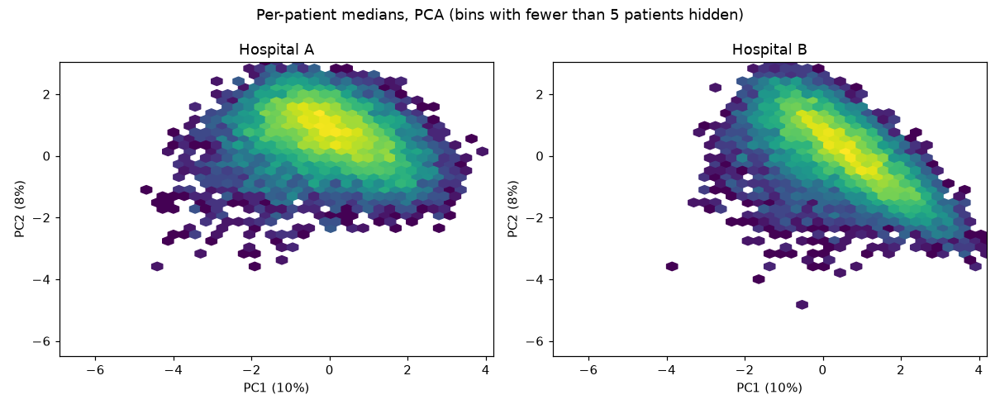
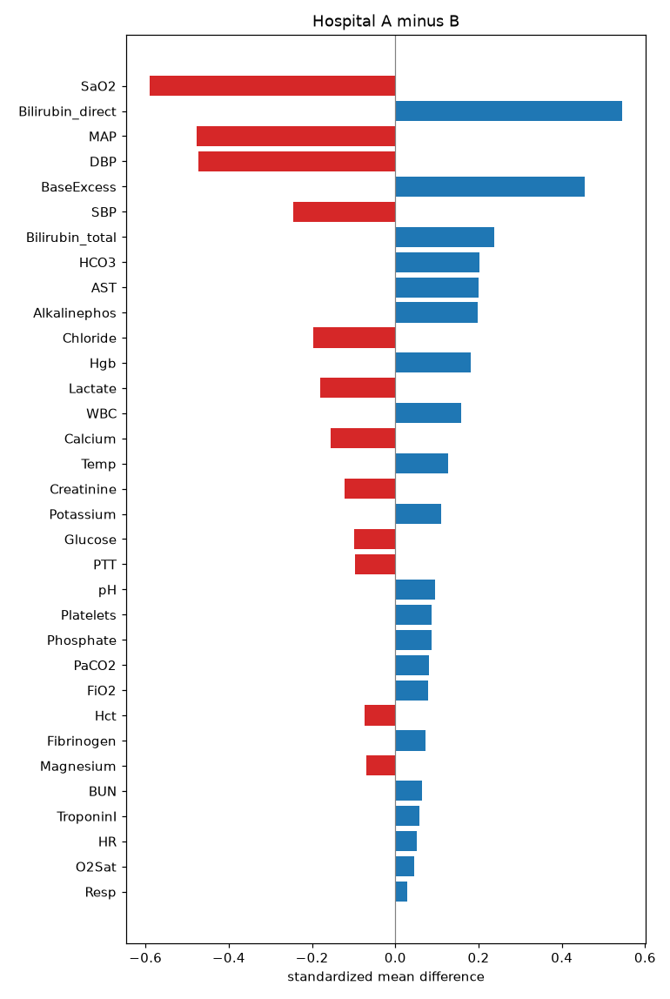

# Exploratory analysis: hospital A vs B (dev patients)

<!-- generated:start (python -m sepsis.eda.run; do not edit by hand) -->
Dev patients only, after the M0-3 cleaning (A: 16268 patients, 632531 patient-hours, B: 16000 patients, 610409 patient-hours). Aggregates only: no patient rows. Settings in `configs/eda.yaml`.

## 1. Cohort

| hospital | patients | patient_hours | septic_pct | hours_p25 | hours_median | hours_p75 | onset_hour_median | septic_on_arrival_pct | iculos_start_after_1_pct |
|---|---|---|---|---|---|---|---|---|---|
| A | 16268 | 632531 | 8.8 | 25.0 | 39.0 | 47.0 | 34.0 | 11.2 | 36.7 |
| B | 16000 | 610409 | 5.7 | 23.0 | 38.0 | 47.0 | 34.0 | 19.7 | 6.4 |

Hours are rows. `onset_hour_median` is t_sepsis (first label row + 6) of septic patients; `septic_on_arrival_pct` is the share of septic patients whose label is 1 within the first 1 row(s).

## 2. Missingness and time between measurements

`pct_hours`: % of hours with a value. `pct_patients`: % of patients with at least one value. `median_hours` / `p90_hours`: median / 90th percentile of rows between two values of the same patient (the p90 sets the look-back windows in `configs/panels.yaml`). Describes how often labs were ordered; never a feature (ADR-0002).

| column | pct_hours_A | pct_hours_B | pct_patients_A | pct_patients_B | median_hours_A | median_hours_B | p90_hours_A | p90_hours_B |
|---|---|---|---|---|---|---|---|---|
| HR | 92.3 | 87.9 | 100.0 | 100.0 | 1.0 | 1.0 | 1.0 | 1.0 |
| O2Sat | 87.9 | 85.8 | 99.9 | 100.0 | 1.0 | 1.0 | 1.0 | 1.0 |
| Temp | 33.7 | 33.8 | 98.9 | 99.8 | 2.0 | 2.0 | 5.0 | 4.0 |
| SBP | 84.8 | 86.0 | 98.7 | 99.9 | 1.0 | 1.0 | 1.0 | 1.0 |
| MAP | 89.7 | 85.2 | 100.0 | 99.5 | 1.0 | 1.0 | 1.0 | 1.0 |
| DBP | 51.5 | 86.0 | 63.4 | 99.9 | 1.0 | 1.0 | 1.0 | 1.0 |
| Resp | 90.2 | 78.9 | 99.9 | 99.8 | 1.0 | 1.0 | 1.0 | 2.0 |
| BaseExcess | 10.4 | 0.2 | 62.1 | 2.8 | 2.0 | 1.0 | 9.0 | 2.0 |
| HCO3 | 8.0 | 0.2 | 97.4 | 2.1 | 8.0 | 1.0 | 24.0 | 3.0 |
| FiO2 | 14.1 | 2.2 | 58.6 | 28.6 | 3.0 | 4.0 | 5.0 | 15.0 |
| pH | 11.5 | 2.2 | 64.7 | 28.3 | 2.0 | 3.0 | 9.0 | 14.0 |
| PaCO2 | 8.8 | 2.2 | 61.8 | 28.4 | 3.0 | 3.0 | 10.0 | 14.0 |
| SaO2 | 5.0 | 1.9 | 39.2 | 25.2 | 2.0 | 3.0 | 9.0 | 15.0 |
| AST | 1.5 | 1.7 | 28.9 | 42.4 | 6.0 | 18.0 | 24.0 | 27.0 |
| BUN | 8.1 | 5.5 | 98.0 | 92.3 | 8.0 | 14.0 | 24.0 | 25.0 |
| Alkalinephos | 1.4 | 1.8 | 28.0 | 42.4 | 6.0 | 17.0 | 24.0 | 27.0 |
| Calcium | 5.0 | 5.4 | 81.5 | 92.0 | 12.0 | 15.0 | 25.0 | 25.0 |
| Chloride | 8.3 | 0.6 | 97.4 | 7.9 | 8.0 | 3.0 | 24.0 | 12.0 |
| Creatinine | 6.6 | 5.5 | 97.8 | 92.3 | 12.0 | 14.0 | 24.0 | 25.0 |
| Bilirubin_direct | 0.1 | 0.2 | 2.9 | 7.2 | 5.0 | 15.0 | 21.6 | 34.0 |
| Glucose | 12.1 | 22.0 | 98.0 | 94.3 | 4.0 | 3.0 | 17.0 | 6.0 |
| Lactate | 3.4 | 1.9 | 37.8 | 23.6 | 2.0 | 3.0 | 12.0 | 12.0 |
| Magnesium | 7.8 | 4.8 | 93.2 | 82.3 | 8.0 | 13.0 | 23.0 | 25.0 |
| Phosphate | 5.0 | 2.9 | 82.2 | 58.3 | 12.0 | 19.0 | 25.0 | 26.0 |
| Potassium | 10.8 | 7.7 | 97.9 | 93.0 | 5.0 | 7.0 | 19.0 | 24.0 |
| Bilirubin_total | 1.2 | 1.8 | 28.3 | 42.5 | 11.0 | 17.0 | 25.0 | 27.0 |
| TroponinI | 0.1 | 1.8 | 2.4 | 32.8 | 8.0 | 7.0 | 18.0 | 16.0 |
| Hct | 11.7 | 5.8 | 98.3 | 90.4 | 5.0 | 11.0 | 18.0 | 25.0 |
| Hgb | 8.8 | 5.9 | 97.5 | 90.5 | 6.0 | 11.0 | 24.0 | 25.0 |
| PTT | 4.8 | 1.0 | 77.6 | 21.9 | 8.0 | 7.0 | 24.0 | 24.0 |
| WBC | 7.5 | 5.3 | 97.0 | 90.2 | 8.0 | 15.0 | 24.0 | 25.0 |
| Fibrinogen | 0.8 | 0.5 | 12.6 | 9.7 | 4.0 | 7.0 | 13.0 | 17.0 |
| Platelets | 6.5 | 5.3 | 97.2 | 90.2 | 12.0 | 14.0 | 25.0 | 25.0 |

## 3. Labs measured together (candidate panels)

Labs clustered on 1 - (how often they share an hour), average linkage, distance threshold 0.6. Input for `configs/panels.yaml` (M0-6).

| hospital | size | labs |
|---|---|---|
| A | 18 | HCO3, AST, BUN, Alkalinephos, Calcium, Chloride, Creatinine, Bilirubin_direct, Glucose, Magnesium, Phosphate, Potassium, Bilirubin_total, Hct, Hgb, PTT, WBC, Platelets |
| A | 5 | BaseExcess, pH, PaCO2, SaO2, Lactate |
| A | 1 | FiO2 |
| A | 1 | Fibrinogen |
| A | 1 | TroponinI |
| B | 15 | AST, BUN, Alkalinephos, Calcium, Creatinine, Bilirubin_direct, Glucose, Magnesium, Phosphate, Potassium, Bilirubin_total, Hct, Hgb, WBC, Platelets |
| B | 8 | BaseExcess, HCO3, FiO2, pH, PaCO2, SaO2, Chloride, Lactate |
| B | 2 | PTT, Fibrinogen |
| B | 1 | TroponinI |

## 4. Septic vs non-septic

Label-1 hours of septic patients against all hours of patients who never become septic. Top 10 per hospital by |standardized mean difference|, among variables with at least 200 values on each side:

| hospital | column | septic_median | nonseptic_median | smd | n_septic | n_nonseptic |
|---|---|---|---|---|---|---|
| B | HR | 90.00 | 82.00 | 0.42 | 7780 | 486571 |
| B | BUN | 26.00 | 17.00 | 0.41 | 705 | 30220 |
| B | FiO2 | 0.50 | 0.40 | 0.39 | 745 | 10509 |
| A | Resp | 20.00 | 18.00 | 0.39 | 12685 | 492803 |
| B | Temp | 37.20 | 36.90 | 0.36 | 3252 | 185962 |
| A | HR | 90.00 | 83.00 | 0.35 | 12856 | 504604 |
| A | BUN | 23.00 | 17.00 | 0.33 | 1333 | 43593 |
| B | WBC | 12.00 | 9.40 | 0.32 | 693 | 28809 |
| A | Temp | 37.30 | 37.00 | 0.28 | 4392 | 185564 |
| B | Bilirubin_total | 1.20 | 0.80 | 0.26 | 348 | 9467 |
| B | SaO2 | 97.10 | 97.50 | -0.25 | 665 | 8865 |
| B | Resp | 19.00 | 18.00 | 0.23 | 6496 | 438769 |
| A | Bilirubin_total | 1.20 | 0.80 | 0.21 | 303 | 6237 |
| B | DBP | 61.00 | 65.00 | -0.20 | 7660 | 475824 |
| A | Creatinine | 1.10 | 0.90 | 0.19 | 1036 | 35863 |
| B | Creatinine | 1.31 | 0.97 | 0.19 | 705 | 30251 |
| A | Hgb | 10.20 | 10.50 | -0.15 | 1420 | 47804 |
| A | WBC | 11.60 | 10.80 | 0.14 | 1207 | 40362 |
| A | PTT | 35.00 | 32.10 | 0.13 | 793 | 25896 |
| A | HCO3 | 24.00 | 24.00 | -0.10 | 1325 | 42946 |

Onset-aligned medians with IQR band, each patient's last value carried forward (earlier hours only) (48 h before to 6 h after t_sepsis, rows; points with fewer than 20 patients hidden). Dashed: median of never-septic patients over hours where the value was measured (not carried forward), so for labs it reflects the patients who got that lab ordered.

## 5. Correlation and redundant variables

Pairs with |Spearman r| >= 0.9, among pairs measured together in at least 500 hours:

| hospital | a | b | r |
|---|---|---|---|
| A | Hct | Hgb | 0.96 |
| A | Bilirubin_direct | Bilirubin_total | 0.95 |
| B | BaseExcess | HCO3 | 0.98 |
| B | Hct | Hgb | 0.97 |

PCA of per-patient medians, as a density (plot only, never a model input):

## 6. Hospital A vs B

Variables with |standardized mean difference| >= 0.2, largest first (values: means over hours with a value):

| column | mean_A | mean_B | smd | pct_hours_A | pct_hours_B |
|---|---|---|---|---|---|
| SaO2 | 91.29 | 96.59 | -0.59 | 4.95 | 1.86 |
| Bilirubin_direct | 3.14 | 1.03 | 0.55 | 0.15 | 0.23 |
| MAP | 78.73 | 86.30 | -0.48 | 89.75 | 85.19 |
| DBP | 59.92 | 66.18 | -0.47 | 51.48 | 85.97 |
| BaseExcess | -0.69 | -2.59 | 0.45 | 10.43 | 0.22 |
| SBP | 120.89 | 126.52 | -0.24 | 84.78 | 86.00 |
| Bilirubin_total | 2.69 | 1.64 | 0.24 | 1.21 | 1.76 |
| HCO3 | 24.08 | 23.30 | 0.20 | 8.02 | 0.18 |
| AST | 346.82 | 175.27 | 0.20 | 1.46 | 1.75 |

<!-- generated:end -->

## Findings

Hand-written after reading the tables and figures above: finding -> what it means for the project. Kept when the analysis is re-run. Variable and panel choices below are proposals; they are decided in M0-6 (panels) and M2 (features), not here.

1. **Same stay pattern, different prevalence and record start.** Stay length (median 39 vs 38 rows) and onset hour (median 34 in both) match, but 8.8% of A patients become septic against 5.7% of B. 36.7% of A records start after ICU hour 1 (B: 6.4%). No record is shorter than 8 rows and few are longer than 60; M0-3 never drops rows, so this comes from how the dataset was built.
   → For a third of A patients, row number and `ICULOS` differ, so `ICULOS` (the strongest single predictor) behaves differently per hospital: compare its importance in A→B and B→A (M3). Read utility differences between hospitals with the prevalence gap in mind.

2. **Many septic patients are labelled from the first row.** 11.2% of septic patients in A (about 160) and 19.7% in B (about 180) have SepsisLabel 1 in their first row, so onset is within about 6 rows of the record start (the spike at the left of the onset histogram). `septic_on_arrival_pct` counts rows, not ICU hours: for late-starting A records the first row is not ICU arrival.
   → These patients have no history before the label window. Keep them, but report them as a separate group when results are analysed (M3).

3. **Charting differs between hospitals, not only patients.**
   - DBP: 51.5% of A hours, and 36.6% of A patients have no DBP at all (B: 86% of hours, 0.1% of patients without). SBP and MAP are nearly complete in both.
   - Blood gas: pH, PaCO2 and FiO2 in 9–14% of A hours vs 2.2% of B (4–6 times rarer). BaseExcess and HCO3 in 0.2% of B hours.
   - TroponinI: 2.4% of A patients vs 32.8% of B. Lactate: 37.8% vs 23.6%. Bilirubin_direct and Fibrinogen are rare in both (under 13% of patients).

   → A model trained on one hospital meets a different missingness pattern in the other. Even without missingness features (ADR-0002), LightGBM's NaN branches can learn "DBP missing" as a hospital marker. Proposal (M2): use MAP and SBP, not DBP. Proposal (M0-6): TroponinI is almost absent in A, so its panel can only be judged in B; lactate is sparse in B for the guideline lactate rule.

4. **Panels: a stable core and four labs that move.** A's 18-lab cluster is B's 15-lab cluster plus HCO3, Chloride and PTT. The blood-gas group (BaseExcess, pH, PaCO2, SaO2, Lactate) is the same in both. In B, HCO3, Chloride and FiO2 join the blood-gas group (and are rare there), and PTT pairs with Fibrinogen.
   → At distance 0.6 the big cluster is too coarse to be one action. Proposal (M0-6): define clinical panels (CHEM, CBC, LFT, ABG, LACTATE, COAG, TROPONIN) and use the clustering as a check, by reporting within-panel co-measurement per hospital. FiO2 is recorded with blood gases and is one of the lab columns, so it stays hidden until revealed and belongs in the ABG panel; treating it as always visible would need a new ADR. HCO3 and Chloride belong to CHEM in A and to the blood gas in B. Panels must be one fixed mapping for both hospitals (nothing chosen on the evaluated hospital, ADR-0004), so put them in one panel for both or leave them out of the panels.

5. **Lab timing sets the look-back window.** Median rows between two values: blood gas and lactate 2–3 in both hospitals (BaseExcess 1 in B, on few values). Chemistry, CBC and liver labs are 5–12 in A and mostly 11–19 in B (Creatinine 12 vs 14, Phosphate 12 vs 19, Bilirubin_total 11 vs 17). Potassium (7), Glucose (3) and Chloride (3) are drawn more often in B, and Glucose and Calcium cover more hours in B than in A.
   → B draws most routine labs somewhat less often than A. Lab windows have to span many hours, not the 4–6 h that suit vitals. The 90th percentile of the gap (`p90_hours`, section 2) is 9–15 rows for blood gas, 12 for lactate and 21–27 for chemistry, CBC, liver and coagulation labs; M0-6 sets the reveal look-back windows from it (`configs/panels.yaml`, ADR-0006), and M2 sets the lab trend windows.

6. **No single strong marker.** The largest septic vs non-septic difference is HR in B (SMD 0.42), then BUN in B (0.41); nothing reaches 0.5. In the 48 h before onset, HR and Temp rise slowly, WBC rises slightly in A, and MAP drops close to onset in both hospitals (A 78.5 → 76.3, B 84 → 80). Resp stays above the never-septic level for the whole window rather than rising. BUN is above the never-septic level throughout in both hospitals; Creatinine and Bilirubin_total are too in B and rise in its last few hours, while in A Creatinine matches the never-septic level and Bilirubin_total ends below it.
   → Single-variable thresholds (B0) will be weak. Expect gains from combinations and from change over time: rolling max/min and 24 h changes (B2, B3).

7. **Labs are ordered when clinicians are worried.** Over measured hours only, never-septic patients have a higher median lactate than septic patients' label-1 hours: 1.80 vs 1.70 in A, 1.94 vs 1.84 in B (pH 7.38 vs 7.39). In the trajectory plot the gap looks larger (septic 1.3–1.6), because the septic line carries earlier, older values forward.
   → Never-septic patients who got lactate were not typical never-septic patients: whether a lab was measured says something about the clinician's concern, which supports ADR-0002 (no count or missingness features). Never fill unmeasured labs with the mean of measured values, since that gives untested patients the values of patients someone was worried about. Keep forward-fill with leading NaN (ADR-0001). In replay, a policy that orders labs routinely will often hit unavailable requests on patients nobody tested; those stay NaN and are never imputed.

8. **Redundant pairs.** Hct–Hgb (r 0.96 in A, 0.97 in B), Bilirubin_direct–Bilirubin_total (0.95 in A, just under 0.9 in B), BaseExcess–HCO3 (0.98 in B). BUN–Creatinine is about 0.7.
   → This matters for B1 logistic (unstable coefficients) and little for LightGBM. It does not change lab cost, because each pair sits in the same panel. Proposal (M2): drop Hct and Bilirubin_direct from the features. Keep Hgb, Bilirubin_total (PartialSOFA), and both BUN and Creatinine (BUN/Creatinine ratio, PartialSOFA). For BaseExcess vs HCO3, note that HCO3 is the more common one in A (97% vs 62% of patients) and the rarer one in B.

9. **Hospitals differ in values.** Blood pressures are lower in A: MAP 78.7 vs 86.3 (SMD −0.48), SBP 120.9 vs 126.5, both measured in about 85–90% of hours, so this is not sparse data. SaO2 is lower in A (91.3 vs 96.6, SMD −0.59) while O2Sat is not flagged; A may record non-arterial saturations as SaO2 (not confirmed). Bilirubin, AST and BaseExcess also differ, but on few hours.
   → Expect a gap between mix and A→B / B→A (M3). A model trained on B sees A's lower pressures as worse and may alarm more in B→A. Fixed cutoffs such as MAP < 70 in PartialSOFA fire more often in A. Fit scalers, fill values and the alarm threshold on the training side only (ADR-0004). Proposal (M2): leave SaO2 out of the features, since O2Sat, pH and PaCO2 cover it.
